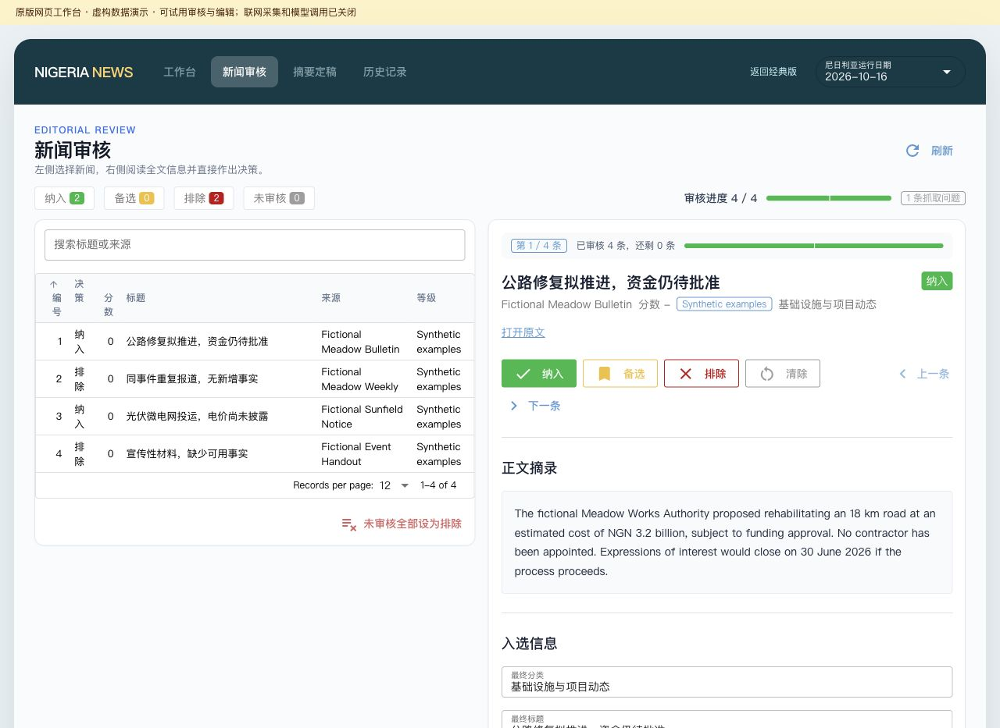

# 尼日利亚新闻编辑工作台

**英文来源 → 人工审核 → 中文简报。**

这是 Zhiqi Fang 独立开发、使用 AI 辅助编程的个人项目。它把新闻发现、筛选、去重、原文审核和中文编辑放进一个可追溯的工作流程，最终取舍和成稿仍由编辑判断。

[English](README.md) · [编辑案例](docs/editorial-examples.md) · [使用说明](docs/usage.md)



## 先看演示

**项目原本就有网站，代码在 `src/news_ui.py`，本版保留了它。** 网站有工作台、新闻审核、摘要定稿和历史记录四个模块，以及经典版和预览版界面。

安装 `requirements.txt` 中的依赖后，运行：

```sh
python scripts/preview_workbench.py
```

浏览器打开 `http://127.0.0.1:8791/`，就能在原网站中试用审核决定、标题/分类/备注编辑和简报格式整理。演示数据放在独立临时目录，联网采集和模型任务被关闭，不读取原工作资料。原有 `/classic`、`/preview-c` 和 `/preview-c2` 界面也保留着。

### 辅助阅读：离线编辑案例

下载后还可直接用浏览器打开 [docs/demo.html](docs/demo.html)。这是补充说明编辑思路的案例页，不是原网站的替代界面。GitHub 页面可先看上方原网站截图和[编辑案例](docs/editorial-examples.md)。

也可用 Python 3.10 及以上版本重现，不需要第三方依赖：

```sh
python scripts/run_demo.py
```

演示使用五条明确标注为虚构的英文短文，调用项目原有的审核解析、决定保存、入选材料准备和简报格式整理代码，生成 `output/demo/` 下的文件和可浏览的演示页。它不会采集真实新闻、读取密钥或调用 AI 服务。页面里的“待修订稿”和“参考编辑稿”是为演示撰写的样例，不冒充真实模型输出。

## 我想解决的问题

英文新闻变成中文简报，困难不只在翻译。相同事件会被多家来源重复报道；标题可能比正文更确定；金额、项目阶段和机构名称也容易在压缩内容时失真。例如，原文只有“拟推进，资金待批准”，中文就不能写成“已获批、已授标”。

因此，我把来源、证据摘录、重复提醒、人工备注和最终用稿决定放在同一条记录中。工具帮助减少重复操作，编辑负责判断信息是否充分、表述是否准确。

## 我的工作

- 设计从发现、筛选、审核到中文成稿的流程，以及纳入／备选／排除等状态。
- 编写事实边界、名称、项目阶段和中文表达要求，约束辅助草稿。
- 借助 AI 编程工具实现 Python 流水线、可编辑的本地工作台与格式整理。
- 检查边界情况，并为审核、数据准备和输出格式编写自动化检查。

展示材料不虚构日处理量、节省时间或准确率。项目有完整工作流代码；本次离线演示验证的是编辑和格式处理环节，不代表已测试实时抓取或真实模型效果。

## 重点看什么

| 编辑问题 | 展示内容 |
|---|---|
| 项目阶段失真 | 保留“拟开展”“待批准”“未披露”等限制，不把计划写成落地 |
| 金额和单位 | 对照原文区分金额、币种、长度和装机容量 |
| 重复与噪声 | 同事件重复稿及无实质信息的宣传材料不进入成稿输入 |
| 正文缺失 | 抓取失败保留为人工核查项，不凭标题生成摘要 |
| 可追溯性 | 英文原文、审核决定、编辑理由与中文参考稿可对应查看 |

完整版本还能通过 RSS 发现新闻、规则及可选 LLM 预筛、评分去重，并在 NiceGUI 本地页面审核与编辑。安装和启动方式见[使用说明](docs/usage.md)。项目不自动安装定时任务，也不自动向外发布简报。

本展示版移除了工作资料、内部数据库引用和原始提交历史；样例均为虚构，链接使用 `example.invalid`，并非真实报道。第三方依赖保留各自许可；目前未选择开源许可。

